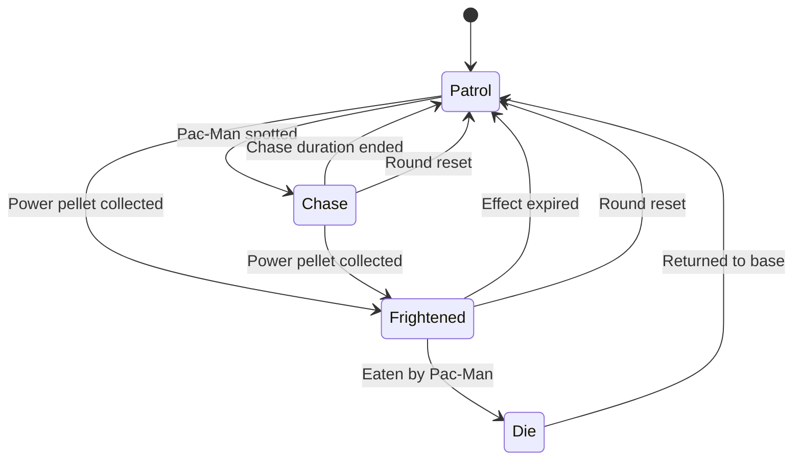
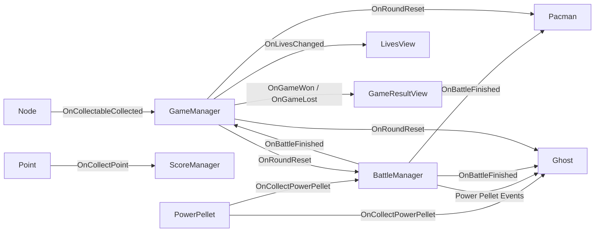

<div align="center">

# 🟡 Pac-Man — Unity

A Pac-Man clone built in **Unity (C#)** featuring an event-driven architecture, state-machine-based ghost AI, and a data-driven level system powered by ScriptableObjects.


</div>


## 🎮 About

This project is a from-scratch Pac-Man implementation focused on **clean, maintainable, and decoupled game architecture**.

The project uses a lightweight **EventBus** system for communication between gameplay systems, a **Finite State Machine (FSM)** to control ghost behavior, and **ScriptableObjects** to manage level configurations and ghost properties.

The data-driven architecture makes it possible to create new levels and ghost types without modifying the core gameplay code.

## ✨ Features

- 🎮 Grid-based movement with input buffering.
- ❤️ Three-life system with automatic character respawning.
- 👻 Multiple ghost types with configurable speeds, colors, and behaviors.
- 🧠 State-machine-based ghost AI.
- ⚡ Power pellets that make ghosts frightened and cause them to flee.
- 💡 Ghost blinking effect before the power-up expires.
- 💥 Distance-based collision detection to prevent missed collisions.
- 🔄 Complete win/lose game loop with automatic scene restart.
- 📡 Generic, type-safe EventBus for decoupled communication.
- 🗺️ Data-driven level configuration using ScriptableObjects.
- 🧱 Procedural wall generation with runtime texture creation and 8x supersampling.
- 🧭 A* pathfinding for ghosts returning to their base.

## 🕹️ Gameplay

### Controls

| Action | Input |
|---|---|
| Move Up | `W` / `↑` |
| Move Down | `S` / `↓` |
| Move Left | `A` / `←` |
| Move Right | `D` / `→` |

### Collectibles

| Item | Effect |
|---|---|
| Point | +10 score |
| Power Pellet | Ghosts become frightened for 15 seconds |
| Ghost Eaten | +200 score; ghost returns to base |

### Game Rules

- Touching a frightened ghost eats it.
- Touching a normal ghost costs one life.
- If Pac-Man touches both frightened and normal ghosts simultaneously, the dangerous ghost takes priority.
- Collecting a power pellet makes ghosts flee for 15 seconds.
- Ghosts blink during the final 3 seconds of the power-up.
- Losing a life resets all characters to their spawn positions, while collected points and score are preserved.
- Collecting all points and power pellets completes the level.
- Losing all three lives ends the game.

After winning or losing, the game briefly displays the result before automatically restarting the level.

## 👻 Ghost AI

Each ghost has its own `GhostStateMachine`, implemented using independent C# state classes with `Enter()`, `Update()`, and `Exit()` methods.

### State Machine



### Ghost Behaviors

| State | Behavior |
|---|---|
| **Patrol** | Moves randomly and changes direction when blocked. Scans up to 5 tiles ahead for Pac-Man. |
| **Chase** | Follows Pac-Man's breadcrumb trail for a configurable duration. |
| **Frightened** | Evaluates possible directions based on Pac-Man's current and predicted positions, moving away from danger. |
| **Die** | Returns to the enemy base using A* pathfinding before re-entering Patrol. |

## 🏗️ Architecture

Gameplay systems communicate through typed events rather than directly referencing one another.

### Event Flow



### Core Systems

| System | Responsibility |
|---|---|
| `GameManager` | Manages game states, lives, win/lose conditions, round resets, and restarts. |
| `BattleManager` | Handles power pellet timers and Pac-Man/Ghost collision rules. |
| `Grid` / `Node` | Generates the level, spawns prefabs, manages neighbors, and provides pathfinding. |
| `Character` | Handles shared tile-based movement and spawn/reset logic. |
| `EventBus` | Provides generic, type-safe event communication between systems. |
| `ScriptableObjects` | Stores level data, ghost configurations, and wall visual settings. |

### Design Decisions

- **Distance-based collision detection:** World positions are checked every frame to detect collisions accurately, including head-on crossings.
- **Typed events:** Event structs carry the required data, avoiding unnecessary component lookups and unsafe base-class casts.
- **Independent ghost states:** Battle outcomes depend on each ghost's actual state rather than a global power-up flag.
- **Frozen timers:** Power-up timers and ghost logic only update while the game is in the `Play` state.
- **State lifecycle management:** Ghost states subscribe to events in `Enter()` and unsubscribe in `Exit()`. `GhostStateMachine.Stop()` ensures cleanup when destroyed.
- **Scene-based restart:** Reloading the scene provides a clean way to reset gameplay systems and level objects.

### Game Loop

```text
                    ┌── All collectibles eaten ──▶ Win ──┐
                    │                                     │
Play ───────────────┤                                     ├──▶ Delay ──▶ Reload Scene
                    │                                     │
                    └── Hit by ghost ──▶ Lives - 1 ──────┘
                                      │
                                      ├── 0 lives ──▶ Lose
                                      │
                                      └── Remaining lives
                                                │
                                                ▼
                                            Respawning
                                                │
                                                ▼
                                            Round Reset
                                                │
                                                └──▶ Play
```

## 📂 Project Structure

```text
Assets/
└── Scripts/
    ├── Events/                # EventBus, IEvent and event structs
    ├── Ghost/                 # Ghost, GhostStateMachine and ghost states
    ├── SO/                    # ScriptableObject definitions and assets
    ├── BattleManager.cs       # Power pellet timer and collision detection
    ├── Character.cs           # Shared movement and spawn/reset logic
    ├── GameManager.cs         # Game states, lives, win/lose and restart
    ├── GameResultView.cs      # Win/lose UI
    ├── LivesView.cs           # Lives UI
    ├── Grid.cs / Node.cs      # Map generation, neighbors and A*
    ├── Pacman.cs
    ├── Point.cs
    ├── PowerPellet.cs
    ├── ICollectable.cs
    ├── ScoreManager.cs
    ├── WallTextureGenerator.cs
    └── Singleton.cs / Helpers.cs / Enums.cs
```

## 🚀 Getting Started

### Requirements

- **Unity 6** (6000.x)
- Unity **Input System** package
- **TextMeshPro**

### Installation

Clone the repository.

1. Open **Unity Hub**.
2. Select **Add → Add project from disk**.
3. Select the cloned project folder.
4. Open the main scene inside `Assets/Scenes/`.
5. Make sure the scene is included in **Build Profiles → Scene List**.
6. Press **Play** to start the game.

### Gameplay Configuration

The following values can be customized:

- Maximum lives.
- Respawn delay.
- Restart delay.
- Ghost death freeze duration.
- Collision hit radius.
- Power pellet duration.
- Collectible scores.

## ⚙️ Configuring Levels & Ghosts

### Level Configuration

Edit the `SO_LevelDesign` ScriptableObject to configure:

- Grid dimensions and node size.
- Wall positions.
- Player spawn position.
- Enemy spawn positions and base.
- Point and power pellet locations.
- Gameplay prefabs.

### Ghost Configuration

1. Create a `GhostConfig` asset.
2. Navigate to **Create → ScriptableObjects → GhostConfig**.
3. Add the configuration to the level's enemy palette.
4. Customize ghost speed, color, and chase duration.

### Wall Visual Settings

Use `WallMapVisualSettings` to customize:

- Wall color.
- Wall thickness.
- Corner radius.
- Pixels per cell.
